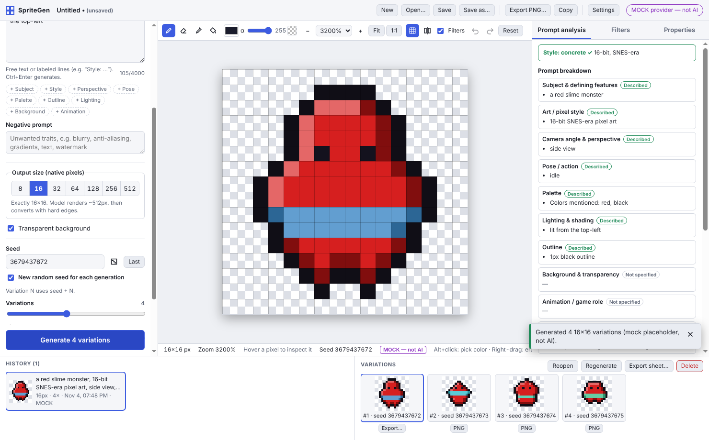
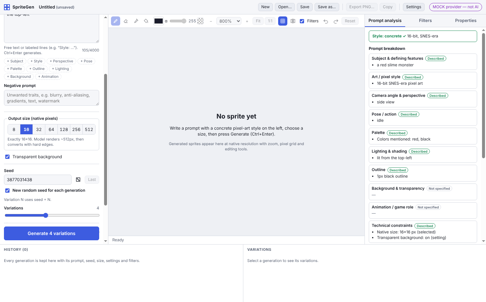
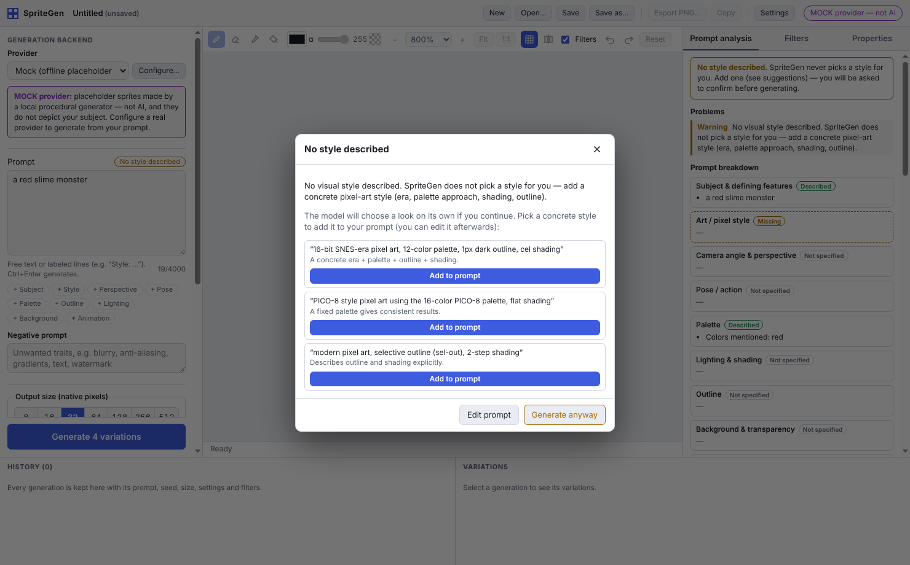
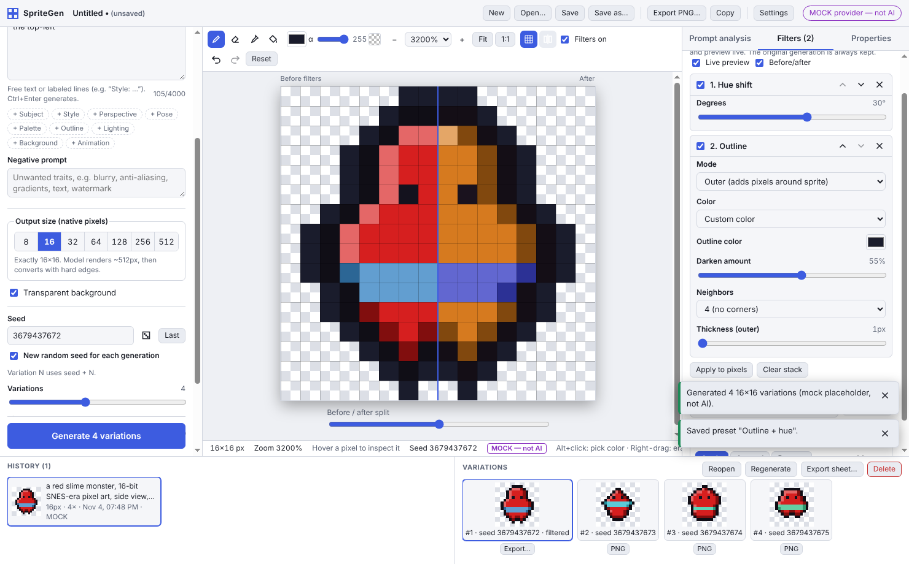
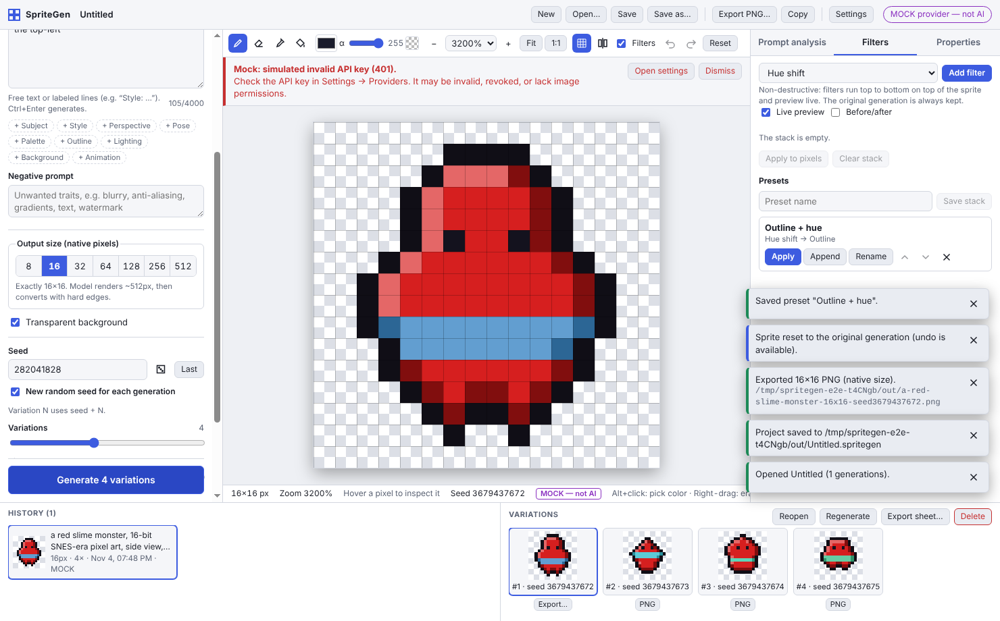

# SpriteGen

SpriteGen is a desktop app that generates pixel-art sprites from text prompts, starting from a blank canvas. Every sprite comes out at an exact native square size: **8×8, 16×16, 32×32, 64×64, 128×128, 256×256 or 512×512**. You then inspect it pixel by pixel, edit it, run non-destructive filters on it, and export it as a transparent PNG.



> **AI vs. mock.** SpriteGen ships with four generation backends. Three are real: **OpenAI Images**, **Stability AI** and a **local Stable Diffusion WebUI** (AUTOMATIC1111/Forge). The fourth, **Mock**, is the default. It is an offline procedural placeholder, *not AI*, and it does not depict your subject. Everywhere it appears it is labeled "MOCK — not AI", so you can try the whole workflow without credentials. The real providers are implemented and unit-tested against recorded/mocked HTTP responses. They have **not** been run against the live services in this repository's CI (no credentials). See [Known limitations](#known-limitations).

---

## Contents

- [Features](#features)
- [Quick start](#quick-start)
- [Connecting a real AI provider](#connecting-a-real-ai-provider)
- [Using the app](#using-the-app)
- [Security](#security)
- [Development](#development)
- [Building and packaging](#building-and-packaging)
- [Architecture](#architecture)
- [Known limitations](#known-limitations)

| Smart prompt viewer | Style warning before generation | Before/after filter compare | Actionable errors |
| --- | --- | --- | --- |
|  |  |  |  |

## Features

| Area | What you get |
| --- | --- |
| **Text-to-sprite** | Prompt and negative-prompt editors with labeled-section helpers (Subject, Style, Perspective, Pose, Palette, Outline, Lighting, Background, Animation). Seven exact output sizes and a transparent background option. Seeds can be typed, randomized, reused from the last run, or reused from history. 1–8 variations per run, provider-specific controls, live progress, cancellation (button or Esc) and actionable error messages. |
| **No silent style** | SpriteGen never adds an art style. If the prompt has no style, or only a generic one like "pixel art", you get a warning with concrete, size-aware suggestions and must confirm before anything is generated. |
| **Smart prompt viewer** | Breaks the prompt into sections: subject, style, perspective, pose, palette, lighting, outline, background/transparency, animation role, technical constraints and negative prompt. Highlights missing and conflicting details, offers optional suggestions you can **accept, edit or reject**, and shows the **exact final prompt** sent to the backend. |
| **Preview & editing** | Native-resolution previews plus zoom from 1× to 6400% with nearest-neighbor display (`image-rendering: pixelated`). A pixel grid appears at high zoom, and hovering shows the pixel's coordinates and RGBA. A before/after split compares filters. Tools: pencil, eraser, color picker (Alt+click), contiguous fill, and drawing with an alpha value or transparent pixels. Undo/redo covers both edits and filter changes. |
| **Filters** | Brightness, contrast, saturation, hue shift, gamma, sharpen, posterize, palette reduction (median cut / k-means), dithering (Floyd–Steinberg, Atkinson, Sierra Lite, Bayer 2/4/8), outline (outer/inner, custom or darkened color, 4/8 neighbors), background removal (auto from edges or a chosen color) and alpha cleanup. Filters form an ordered, non-destructive pipeline with a live preview. "Apply to pixels" bakes them in, and "Reset" restores the original generation. |
| **Presets** | Save the current filter stack as a preset. Presets can be renamed, reordered, deleted, applied (replacing the stack) or appended. |
| **History & projects** | Each generation stores its prompt, negative prompt, seed(s), size, provider settings, conversion settings, final prompt, timestamp, images and per-variation filter stacks. You can reopen or regenerate any entry. Projects save and load as `.spritegen` files, and the session autosaves. |
| **Export** | Native-size PNG with alpha, optional enlarged preview (2×–32× nearest-neighbor, clearly labeled and suffixed `@Nx`), copy to clipboard, and per-variation PNG or sprite-sheet export. |

## Quick start

Requirements: **Node.js 20+** (developed with Node 22.23) and npm 10. You also need a desktop session: Windows 10+, macOS 12+, or Linux with X11/Wayland.

```bash
npm install
```

```bash
npm run dev
```

`npm run dev` starts the app with hot reload. Pick the **Mock** provider (the default), type a prompt that names a style, and press **Generate** (Ctrl/Cmd+Enter). For example:

> a red slime monster, 16-bit SNES-era pixel art, side view, idle, 1px black outline, lit from the top-left

Troubleshooting:

- **"Electron failed to install correctly"**: the Electron binary download was skipped. Run `node node_modules/electron/install.js`.
- **Running as root (some containers/CI)**: Chromium refuses to start without `--no-sandbox`. Use `npx electron-vite dev --noSandbox`. Don't do this on a normal desktop.

## Connecting a real AI provider

Open **Settings → Providers** (Ctrl/Cmd+,), select a provider, and fill in its settings. Use **Test connection** to verify, then **Use this provider**.

| Provider | Needs | Seeds | Negative prompt | Transparency |
| --- | --- | --- | --- | --- |
| **OpenAI Images** (`gpt-image-1` default; `dall-e-3` also supported) | API key (`OPENAI_API_KEY`) | ✗ not reproducible | merged into the prompt as "Avoid: …" | native (gpt-image models) |
| **Stability AI** (Stable Image Core / Ultra) | API key (`STABILITY_API_KEY`) | ✓ | ✓ separate field | background removal during conversion |
| **Local Stable Diffusion** (AUTOMATIC1111 / Forge WebUI) | WebUI started with `--api`; URL (default `http://127.0.0.1:7860`) | ✓ | ✓ | background removal during conversion |

There are two ways to supply API keys:

1. **In the app** (recommended): paste the key into Settings and leave **Remember securely in the OS credential store** checked. The key is encrypted with the OS keychain (see [Security](#security)).
2. **Environment variable**: set `OPENAI_API_KEY` or `STABILITY_API_KEY` before launching. A key stored in the app takes precedence.

For the local WebUI, a pixel-art checkpoint or LoRA gives much better results than a general model. The Stability "pixel-art" style preset is available but is **only sent if you select it**.

To add a different backend, see [docs/PROVIDERS.md](docs/PROVIDERS.md). It takes one new module implementing the `GenerationProvider` interface and one line in the registry. No UI changes are needed.

## Using the app

The window has four panels:

- **Left:** provider, prompt, negative prompt, size, transparency, seed, variations, provider parameters, and the collapsible *Technical constraints & pixel conversion* section.
- **Center:** the editing toolbar, progress/error banner, sprite canvas and status bar (pixel inspector).
- **Right:** three tabs. **Prompt analysis** is the smart prompt viewer, **Filters** holds the filter stack and presets, and **Properties** shows native previews, seed, palette and conversion notes.
- **Bottom:** generation **History** and the selected generation's **Variations**.

### How a prompt becomes a sprite

1. The final prompt is your text plus up to three neutral, individually toggleable **technical constraints**: "single centered subject…", "readable silhouette at N×N", and "isolated on a transparent/plain background". None of them sets an art style, and the viewer shows exactly what is appended.
2. The provider renders at its working resolution (about 512–1024px).
3. A documented **pixel-art conversion** turns the result into the exact native size with hard edges: center-crop → optional background removal → palette quantization → nearest-neighbor (or dominant-color) downscale → alpha binarization. See [docs/PIXEL_PIPELINE.md](docs/PIXEL_PIPELINE.md). The steps applied to each sprite are listed under *Properties → Pixel conversion applied*.
4. The response is validated before anything is shown or saved: PNG signature, dimensions, buffer sizes, and an exact N×N result.

### Keyboard shortcuts

| Action | Shortcut |
| --- | --- |
| Generate / cancel | Ctrl/Cmd+Enter / Esc |
| Undo / redo (sprite) | Ctrl/Cmd+Z / Ctrl+Y (Cmd+Shift+Z on macOS). Inside text fields these undo text instead. |
| Tools | B pencil · E eraser · I picker · G fill · Alt+click picks · right-drag erases |
| Zoom | Ctrl/Cmd+= / Ctrl/Cmd+- / Ctrl/Cmd+9 fit / Ctrl/Cmd+0 native 1× · Ctrl+wheel |
| Grid / before-after compare | Ctrl/Cmd+' / Ctrl/Cmd+B |
| New / open / save / save as | Ctrl/Cmd+N / O / S / Shift+S |
| Export PNG / sprite sheet / copy | Ctrl/Cmd+E / Shift+E / Shift+C |
| Settings | Ctrl/Cmd+, |

All controls have visible labels and tooltips and can be reached with the keyboard. Tabs support arrow keys, and dialogs trap focus and close with Esc.

### Export rules

- **1× is the default and exports the exact native pixels.** Nothing is resized.
- Enlarged exports (2×–32×) use nearest-neighbor only. The dialog states the real output size, warns that it is not the native size, and the file name gets an `@Nx` suffix.
- *Include active filters* (on by default) exports what you see on the canvas. Turn it off to export the base pixels.
- A sprite sheet packs all variations of a generation 1:1 into a grid with transparent empty cells.

### Where data lives

Preferences (including filter presets), the encrypted key file and the session autosave are stored in the per-user app data folder:

- Linux: `~/.config/SpriteGen`
- macOS: `~/Library/Application Support/SpriteGen`
- Windows: `%APPDATA%\SpriteGen`

The exact path is shown in Settings → Preferences. Projects are saved wherever you choose. A `.spritegen` file is versioned JSON with embedded PNGs. Corrupted or incompatible files are rejected with a specific message, and nothing is half-loaded.

## Security

- **API keys never reach the UI process.** They live only in the main process. The renderer only learns *whether* a key is configured and where it came from.
- **OS credential storage.** Keys are encrypted with Electron `safeStorage` (macOS Keychain, Windows DPAPI, Linux libsecret/KWallet), and only the ciphertext is written (`secrets.json`). On Linux without a keyring, Electron falls back to an insecure built-in password (`basic_text`). SpriteGen detects this and **refuses to persist**: the key is kept in memory for the session only, or you can use an environment variable.
- **No secrets in source.** Nothing is hard-coded, and keys are excluded from logs, projects and error messages.
- **Hardened Electron.** `contextIsolation`, `sandbox` and `nodeIntegration: false` are set. A narrow typed preload bridge is the only API. IPC messages from other origins are rejected, and every IPC payload is validated with zod in the main process. A strict Content-Security-Policy is applied (relaxed only on the dev server for hot reload). In-app navigation and new windows are blocked; `https` links open in the system browser.
- **Untrusted input is validated.** This covers prompts, seeds, sizes, filter parameters, provider responses, project files (schema plus decoding and size checks for every image) and export requests.

## Development

```bash
npm run dev          # app with hot reload (electron-vite)
npm test             # unit tests (vitest): core, main process, renderer logic
npm run typecheck    # TypeScript for main/preload/core, renderer, and e2e
npm run test:e2e     # builds, then drives the real Electron app with Playwright
```

On headless Linux, run the end-to-end tests under a virtual display:

```bash
xvfb-run -a npm run test:e2e
```

The unit tests cover:

- image dimensions for every size
- nearest-neighbor resizing (no new colors, exact block replication, round-trips)
- transparency and alpha binarization
- every filter, dithering, quantization and the pipeline
- prompt analysis (style, sections, conflicts) and final-prompt composition
- request/project validation and corrupted files
- PNG encoding and export sizes
- secrets and preferences storage
- each provider's request and response handling, including error mapping, with mocked HTTP
- cancellation, and undo/redo

The end-to-end suite (`tests/e2e/smoke.spec.ts`) exercises the acceptance workflow in the running app with the Mock provider:

- style warning
- exact final prompt
- generation at native size
- filters, reordering and presets
- undo and reset
- PNG export (checked for size and alpha)
- project save and reopen
- error reporting
- settings
- clipboard
- seed-reproducible regeneration
- cancellation

To run it against a packaged build, set `SPRITEGEN_E2E_EXECUTABLE=release/linux-unpacked/spritegen`.

Environment variables used by the tests: `SPRITEGEN_USER_DATA` (throwaway profile folder), plus `SPRITEGEN_E2E_DIR` / `SPRITEGEN_E2E_OPEN`. The last two bypass the native save/open dialogs and are **test-only**; don't set them for normal use.

## Building and packaging

```bash
npm run build        # compile to out/ (main, preload, renderer)
npm start            # run the compiled build (electron-vite preview)
npm run icon         # regenerate build/icon.png from the pixel-art source in scripts/make-icon.mjs
npm run dist:dir     # unpacked app for the current OS in release/ (fast smoke test)
npm run dist:linux   # AppImage + .deb
npm run dist:win     # NSIS installer (build on Windows, or Linux with Wine)
npm run dist:mac     # .dmg + .zip (build on macOS)
```

Packaging uses [electron-builder](https://www.electron.build/) with `electron-builder.yml`. **Code signing and notarization are not configured.** Add your certificates via electron-builder's standard environment variables (`CSC_LINK`, `CSC_KEY_PASSWORD`, Apple notarization credentials) before distributing. In this repository, the Linux unpacked build was produced and passes the full end-to-end suite. Windows and macOS targets are configured but were not built here.

## Architecture

```
src/
  core/       Pure TypeScript, no Node/DOM: image model, nearest-neighbor resize, filters,
              quantize/dither, pixel conversion pipeline, prompt analysis & composition,
              procedural mock sprites. Shared by main and renderer; heavily unit-tested.
  shared/     Types, IPC contract, zod schemas, error model.
  main/       Electron main process: window/menu, IPC handlers, GenerationService,
              ProviderService, providers/ (mock, openai, stability, automatic1111),
              PNG codec, secrets (safeStorage), preferences, project I/O, export.
  preload/    contextBridge API (window.spriteGen) — the renderer's only capability.
  renderer/   React UI + zustand store (left/center/right/bottom panels, dialogs).
tests/        core/, main/, renderer/ unit tests (vitest) and e2e/ (Playwright + Electron).
docs/         ARCHITECTURE.md, PIXEL_PIPELINE.md, PROVIDERS.md, screenshots/.
```

There are two key design points:

1. **One source of truth for prompts.** `composeFinalPrompt` in `src/core/prompt/compose.ts` builds the preview shown in the prompt viewer *and* the prompt the main process sends, so the viewer is exact.
2. **Provider interface.** Each backend declares its capabilities (seed, negative prompt, native transparency, working size) and its settings/controls as data. The UI renders from those declarations, and the generation service applies the same conversion and validation to every backend.

Details are in [docs/ARCHITECTURE.md](docs/ARCHITECTURE.md).

## Known limitations

- **Real providers aren't verified against live services here.** OpenAI, Stability AI and AUTOMATIC1111 integrations follow their public REST APIs and are tested with mocked HTTP responses. They have not been exercised with real credentials in this repository, and provider APIs and model names change. The Mock provider is the only backend verified end-to-end.
- **OpenAI image models ignore seeds**, so OpenAI results are not reproducible. The UI says so, and the seed is still recorded.
- **Prompt analysis is heuristic.** It uses English keyword lexicons and labeled lines, so it can misclassify unusual phrasing. It only advises and never changes your prompt on its own.
- **Tiny sizes are inherently hard.** Converting about 1024px output to 8×8 or 16×16 loses detail, and nearest-neighbor sampling of noisy output can leave stray pixels. Use *Dominant color* downscale, a custom working palette, or the palette/outline filters, and prefer simple prompts. There is no automatic detection of a "fake pixel grid" in model output.
- **Mock output is placeholder art.** It is procedural, ignores the subject, and only reacts to a few color/outline words and transparency.
- **Undo history is in memory only.** It is not saved in project files, and is capped at 100 steps per sprite. *Reset to original* always works because the original generation is stored.
- **Pixel editing needs a mouse or pen.** There is no keyboard-driven pixel cursor. All other controls are keyboard-accessible.
- **Filters run on the UI thread.** That is fine up to 512×512 (each filter measured below 40 ms at 512² on the dev machine), but very long stacks on 512px sprites may feel less fluid.
- **Autosave re-encodes the whole project** after changes. Very large projects (hundreds of 512px sprites) will autosave slowly. You can disable it in Preferences.
- **Clipboard transparency depends on the target app.** The image is placed on the clipboard as PNG, and some applications drop alpha on paste.
- **Presets are global.** They live in preferences, not inside project files.
- **Sprite sheets are simple grids.** There is no padding option and no animation/atlas metadata.
- **No code signing, auto-update or `.spritegen` file association.**
- **Platform coverage.** Developed and tested on Linux (Xvfb). Windows/macOS should work (Electron, standard APIs) but were not run here. On Linux, persisting keys requires a Secret Service keyring (GNOME Keyring or KWallet).
