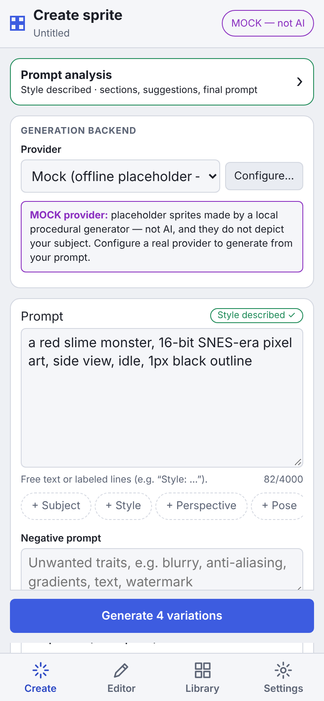
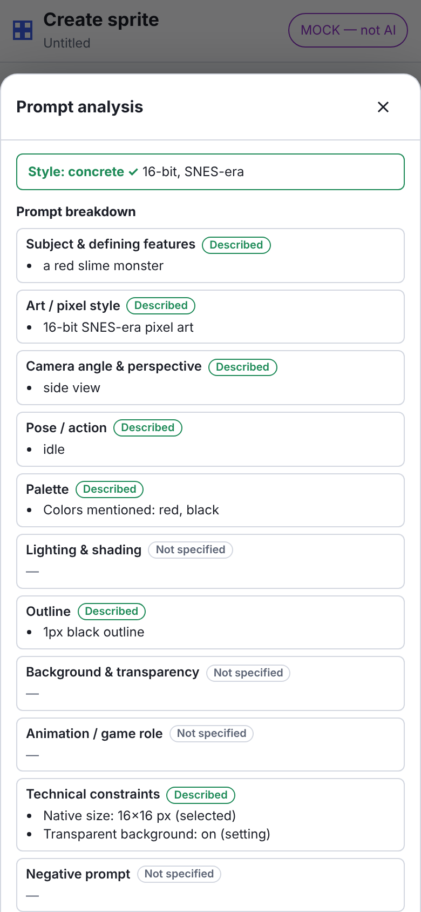
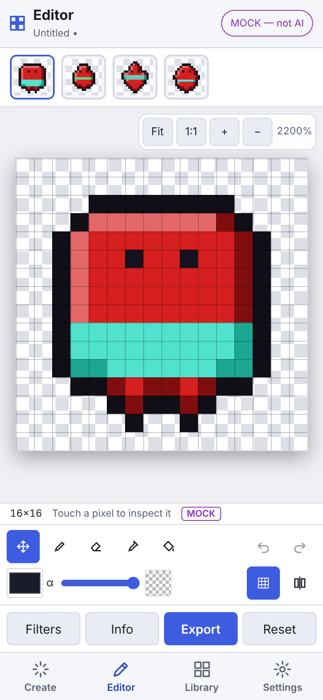
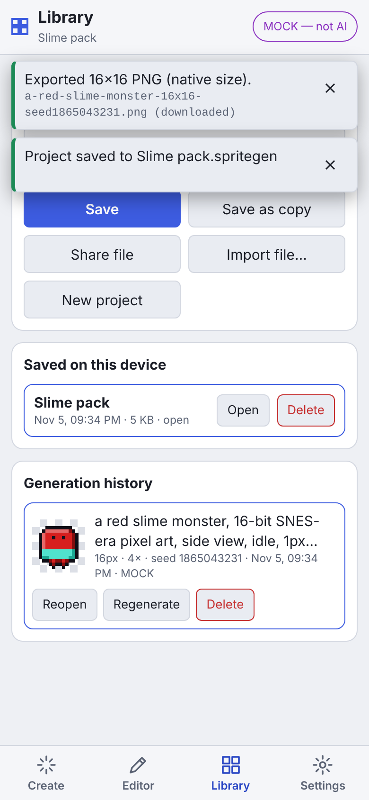

# SpriteGen Mobile (Android & iOS)

The mobile app is the same SpriteGen, rebuilt for touch screens. It is a [Capacitor](https://capacitorjs.com/) app: the UI runs in the system WebView, and native plugins provide storage, the Keychain/Keystore, HTTP and the share sheet. Generation, pixel conversion, validation, filters, prompt analysis, projects and export use **the same code as the desktop app** (`src/core`, `src/backend`, and the shared UI store and panels), so behavior matches desktop.

| Phone (390×844) | Analysis sheet | Editor | Library |
| --- | --- | --- | --- |
|  |  |  |  |

## What's in the app

The app has four tabs: **Create**, **Editor**, **Library** and **Settings**.

### Create

- Provider choice; the **Mock** provider is labeled *not AI* everywhere.
- Prompt with section chips, negative prompt, all seven native sizes, transparency, seed (type, dice or last), variations and provider parameters.
- Technical constraints and pixel-conversion settings.
- **Prompt analysis** opens as a bottom sheet with:
  - the section breakdown
  - missing/conflicting details
  - suggestions you can accept, edit or reject
  - the **exact final prompt**
- A missing or vague style still requires confirmation, with suggestions, before anything is generated.
- Progress, cancel and actionable errors appear in a banner that stays visible on every tab.

### Editor

- The new sprite opens automatically after generation.
- Gestures:
  - **One finger** draws with the active tool: pencil, eraser, picker or fill.
  - **Move** mode pans.
  - **Two fingers** always pinch-zoom and pan. A second finger cancels the stroke the first one started, so pinching never leaves stray pixels.
- **Fit** and **1:1** (one sprite pixel per screen point) buttons. Zoom goes up to 6400%, and the pixel grid appears at high zoom.
- Display scaling is nearest-neighbor only.
- Touch a pixel to see its coordinates and RGBA.
- Color, alpha and transparent-pixel drawing; undo/redo; before/after split.
- Bottom sheets: **Filters** (the full non-destructive stack plus presets) and **Info** (native preview, palette, conversion notes, prompt sent).
- **Export** is the same dialog as desktop, with native 1× by default and labeled nearest-neighbor enlargements. **Reset** restores the original generation.

### Library

- **Current project:** rename it; *Save* and *Save as copy* to app storage; *Share file* (a `.spritegen` file, the same format desktop opens); *Import file…* (the system document picker); *New project*.
- **Saved on this device:** open or delete saved projects. Saving never overwrites a *different* project: a name clash gets "Name 2", and renaming moves the file.
- **Generation history:** open in the editor, *Reopen* settings, *Regenerate* (seed-locked), or *Delete*.

### Settings

- Provider configuration: API key, model/URL, *Test connection*, *Use this provider*.
- Preferences: theme, default size, grid threshold, autosave.
- About: version, platform, key storage, data location.

### Platform behavior

- **Export / share:** PNGs and sprite sheets are handed to the OS share sheet (Save Image, Save to Files, AirDrop, messaging apps…). In a plain browser they download instead.
- **Autosave:** when enabled, the session is saved whenever it changes and again when the app goes to the background, then restored on the next launch.
- **Android back button:** closes the open dialog or sheet first, then returns to Create, then minimizes the app.

## Security on mobile

- **API keys** are stored in the **iOS Keychain / Android Keystore**, via `@aparajita/capacitor-secure-storage`. They never go into Preferences, project files or the autosave. In a plain browser there is no secure store, so keys are kept for the session only. This is the same rule desktop applies to Linux without a keyring.
- **Native HTTP.** Provider requests go through `CapacitorHttp` (`src/mobile/platform/nativeFetch.ts`), not the WebView, so cloud APIs work without CORS exceptions.
- **HTTPS for keys.** The app refuses to send an API key over plain `http://` to anything except `localhost`. This check is in the shared backend, so desktop enforces it too.
- **Plain-HTTP exception for local servers.** Plain HTTP is allowed only so a self-hosted Stable Diffusion WebUI on your network can be reached:
  - Android: `network_security_config.xml`
  - iOS: `NSAllowsLocalNetworking`, plus the local-network privacy prompt
- **WebView hardening.** The page has a strict Content-Security-Policy (`script-src 'self'`; Capacitor's bridge script is injected before the policy takes effect). There is no remote code; the app ships its own web assets.

## Requirements

| Target | Needs |
| --- | --- |
| Web build / tests | Node.js 20+ (same as desktop) |
| Android | JDK 21, Android SDK with platform 36 and build-tools 36 (Android Studio installs both). The app supports Android 7.0 (API 24) and later. |
| iOS | macOS with Xcode 16+. The app supports iOS 15 and later. Plugins are wired with Swift Package Manager, so CocoaPods is not needed. |

## Commands

```bash
npm install
```

```bash
npm run mobile:dev        # mobile UI in a browser with hot reload (http://localhost:5174) — use device emulation in DevTools
npm run mobile:build      # production web build → out/mobile
npm run test:mobile-e2e   # builds, then runs the touch workflow suite on phone + tablet viewports
npm run mobile:sync       # build + copy web assets/plugins into mobile/android and mobile/ios
npm run mobile:android    # sync, then open the project in Android Studio (run on a device/emulator from there)
npm run mobile:apk        # sync, then build a debug APK: mobile/android/app/build/outputs/apk/debug/app-debug.apk
npm run mobile:ios        # sync, then open the project in Xcode (macOS only)
npm run mobile:icons      # regenerate launcher icons + splash screens from the pixel-art source
```

To install the debug APK on a phone with USB debugging enabled:

```bash
adb install -r mobile/android/app/build/outputs/apk/debug/app-debug.apk
```

### Release builds

- **Android:** create a signing key, add a `signingConfigs` block to `mobile/android/app/build.gradle` (or use Android Studio → *Generate Signed Bundle*), then run `./gradlew bundleRelease` in `mobile/android` for Play Store `.aab` files.
- **iOS:** open `mobile/ios/App/App.xcodeproj`, choose your Team under *Signing & Capabilities*, then *Product → Archive*.

App id: `com.spritegen.mobile` (set in `capacitor.config.ts`; changing it later also requires changing the native projects).

## Connecting a provider from a phone

- **OpenAI / Stability AI:** paste the key in Settings → Providers with *Remember securely* on, then tap *Test connection*.
- **Stable Diffusion WebUI on your computer:** start it with `--api --listen` and set the URL to your computer's LAN address, e.g. `http://192.168.1.20:7860`. `127.0.0.1` on a phone means the phone itself. The Android emulator reaches the host computer at `http://10.0.2.2:7860`. On iOS, allow the local-network prompt the first time.

## How it's built

```
src/mobile/
  index.html, main.tsx        entry: creates the platform + in-app backend, sets window.spriteGen, renders MobileApp
  MobileApp.tsx               shell: top bar, global progress/error banner, tabs, back button, background autosave
  state.ts                    mobile UI state (tab, touch tool, open sheet)
  components/                 CreateScreen, EditScreen, MobileCanvas (gestures), LibraryScreen, SettingsScreen, MobileDialogs
  platform/
    types.ts                  MobilePlatform interface (storage, files, secrets, fetch, share, clipboard, file picker)
    backend.ts                SpriteGenApi implemented in-app on top of src/backend (+ project library)
    capacitorPlatform.ts      Capacitor plugins on Android/iOS; web fallbacks in a browser
    nativeFetch.ts            fetch() over CapacitorHttp
  mobile.css                  touch layout over the shared desktop stylesheet
mobile/android, mobile/ios    native projects (generated by Capacitor, then customized: icons, splash, network/privacy config)
capacitor.config.ts, vite.mobile.config.ts
```

The Capacitor packages are listed under `devDependencies` for three reasons:

- Vite bundles them into the mobile web build.
- `cap sync` still discovers native plugins from `devDependencies`.
- Keeping them out of `dependencies` keeps them out of the desktop installer.

Desktop and mobile share one contract, `SpriteGenApi` in `src/shared/ipc.ts`:

- **Desktop:** the Electron main process implements it over IPC.
- **Mobile:** `createMobileBackend()` implements it directly in the app. Platform specifics sit behind `MobilePlatform`, so the backend is unit-tested with an in-memory platform (`tests/mobile/`).

## Verification status

**Verified in this repository**

- Unit tests for the mobile backend and the native HTTP adapter.
- `npm run test:mobile-e2e`: Chromium with touch emulation at 390×844 (phone) and 820×1180 (tablet). It covers:
  - style warning, analysis sheet with the exact prompt
  - generation into the editor at native size, pencil and undo
  - two-finger pinch zoom
  - filters
  - PNG export (16×16 with alpha)
  - Library save, rename, new and reopen
  - settings, error banner, seed-reproducible regeneration
- **Android builds.** `./gradlew assembleDebug` produced `app-debug.apk` (about 4.3 MB) with JDK 21, Android SDK 36 and Gradle 8.14. `aapt2` inspection confirms:
  - package `com.spritegen.mobile`, version 0.1.0, target SDK 36
  - the network security config is applied
  - the web app is bundled
  - all five native plugins are registered
- `cap sync` wires the same five plugins into the iOS Swift Package.

**Not verified here**

- Running on a real Android device/emulator or on iOS (there is no Android emulator or macOS in this environment).
- On a real device, check the native-only parts:
  - Keychain/Keystore storage
  - the share sheet
  - the document picker
  - CapacitorHttp requests
  - the back button
  - safe-area insets
- The iOS project was generated but not built (it needs Xcode).

## Mobile-specific limitations

- Generation and conversion run on the WebView's main thread. Converting a 1024px model image can make the UI pause for a moment on slower phones.
- Copying images to the clipboard depends on WebView support; use *Share → Copy* where it is missing.
- There is no keyboard-driven pixel editing on mobile (the same as desktop: pixel editing needs touch, mouse or pen).
- In a plain mobile browser (the `mobile:dev` / preview build):
  - API keys are session-only.
  - Exports download instead of opening a share sheet.
  - Cloud providers may reject direct browser requests (CORS). The native apps don't have this problem.
